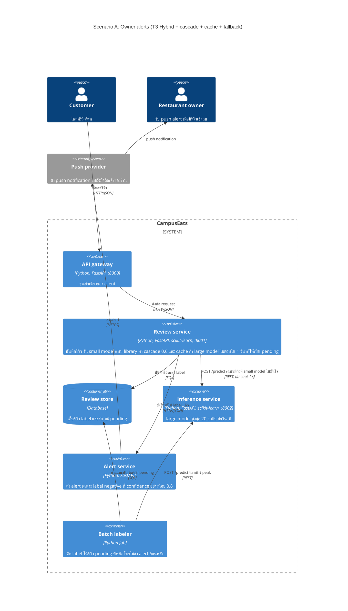

# Task 4: Deployment topologies and trade-offs

**Name / ชื่อ:** อภิวัชร ผดุงอรรถ

**Student ID / รหัสนิสิต:** 6970314621

This is **individual work**: each student completes and submits their own copy, in their own fork.

*งานนี้เป็น**งานเดี่ยว** นิสิตแต่ละคนทำและส่งงานของตัวเอง ใน fork ของตัวเอง*

**Scenario (A, B or C) / Scenario ที่เลือก:** A. Owner alerts

Choose **one** scenario below. If the last digit of your student ID is odd, take A or B; if it is even, take B or C. Use your measurements from Tutorial 6 as evidence: cite run names from `results/runs.csv`. Answer in Thai or English.

เลือก scenario **หนึ่ง** ข้อด้านล่าง ถ้าเลขตัวสุดท้ายของรหัสนิสิตเป็นเลขคี่ ให้เลือก A หรือ B ถ้าเป็นเลขคู่ ให้เลือก B หรือ C ใช้ผลการวัดจาก tutorial ที่ทำไปเป็นข้อมูลอ้างอิง โดยอ้างชื่อ run จาก `results/runs.csv` จะตอบเป็นภาษาไทยหรือภาษาอังกฤษก็ได้

Facts that hold in every scenario / ข้อเท็จจริงที่ใช้กับทุก scenario:

- The large model serves at most **20 calls per second** (4 calls at once × about 200 ms each), and every call costs money.

  *large model รับได้สูงสุด **20 calls ต่อวินาที** (พร้อมกัน 4 calls × ประมาณ 200 ms ต่อ call) และทุก call มีค่าใช้จ่าย*
- The small model is fast and cheap enough to run anywhere, including inside the review service or on a kiosk, but it is much less accurate on its own.

  *small model เร็วและถูกพอที่จะรันที่ไหนก็ได้ รวมถึงภายใน review service หรือบน kiosk แต่ถ้าใช้ตัวเดียวจะแม่นน้อยกว่ามาก*

## Scenarios

**A. Owner alerts.** When a customer posts a negative review, the restaurant owner gets a push notification within **2 seconds**. At the lunch peak, CampusEats receives **40 reviews per second**. A missed alert is acceptable, but a wrong alert (for example, "your customer is unhappy" when they are happy) makes owners stop trusting alerts and, in the end, ignore them.

*เมื่อลูกค้าโพสต์รีวิวเชิงลบ เจ้าของร้านจะต้องได้รับ push notification ภายใน **2 วินาที** เวลาช่วงพีคตอนเที่ยง CampusEats ได้รับรีวิวจำนวน **40 รายการต่อวินาที** การพลาด alert ไปบ้างนั้นยอมรับได้ แต่ alert ที่ผิด (เช่น "ลูกค้าไม่พอใจ" ทั้งที่จริงๆ แล้วพอใจ) จะทำให้เจ้าของร้านไม่เชื่อถือและเลิกสนใจ alert ในที่สุด*

**B. Canteen kiosk.** A tablet in each canteen lets students leave a review on the spot. However, the canteen Wi-Fi is poor: the tablets lose their connection several times a day, for minutes at a time. The system must accept every review, even while a tablet is offline. Restaurant owners need the labels **by the end of the day**.

*มี tablet ในแต่ละโรงอาหารให้นิสิตรีวิวได้ทันที อย่างไรก็ดี การเชื่อมต่อ Wi-Fi ในโรงอาหารไม่ดี ทำให้ tablet หลุดการเชื่อมต่อวันละหลายครั้ง ครั้งละหลายนาที ระบบจะต้องรับรีวิวได้ทุกรายการแม้ขณะที่กำลัง offline อยู่ และเจ้าของร้านต้องการ label **ภายในสิ้นวัน***

**C. Weekly report.** Restaurant owners want a weekly sentiment report. Nothing in producing this report has to be real-time. **Accuracy matters most** and **cost must be minimal**.

*เจ้าของร้านต้องการรายงาน sentiment รายสัปดาห์ ไม่มีอะไรที่จะต้องทำแบบ real-time ในการออกรายงานนี้ ความแม่นยำ **(accuracy) สำคัญที่สุด** และ **ค่าใช้จ่ายต้องน้อยที่สุด***

## Topologies and patterns to choose from / Topology และ pattern ที่เลือกใช้ได้

| | Topology | Where the model runs / โมเดลรันที่ไหน |
|---|---|---|
| T1 | Model as a service, synchronous | Inference service, called for each review (today's baseline) *inference service ถูกเรียกทุกรีวิว (baseline ของวันนี้)* |
| T2 | Model as a library | Inside the review service, or on the device *ภายใน review service หรือบนอุปกรณ์* |
| T3 | Hybrid | Small model locally, large model as a remote service *small model รันในเครื่อง large model เป็น remote service* |
| T4 | Asynchronous / batch | Reviews are queued (broker, W10) or stored, and scored later in bulk *รีวิวถูกเข้าคิว (broker, W10) หรือเก็บไว้ แล้วติด label ทีหลังเป็นชุด* |

Combine one topology with any of the patterns from Tutorial 6: **fallback**, **cascade** and **cache**.

*เลือก topology หนึ่งแบบ แล้วผสมกับ pattern จาก Tutorial 6 ได้ตามต้องการ: **fallback**, **cascade** และ **cache***

## 1. Quality requirements

The three most important quality requirements for your scenario, each with a number where possible.

*quality requirements ที่สำคัญที่สุด 3 ข้อของ scenario ที่เลือก ระบุตัวเลขเมื่อทำได้*

| # | Quality | Requirement |
|---|---|---|
| 1 | Performance (ความเร็วของ alert) | เจ้าของร้านได้รับ alert ภายใน 2 วินาทีหลังลูกค้าโพสต์รีวิว ที่ peak 40 รีวิว/วินาที โดยขั้น inference ใช้ไม่เกิน 1 วินาที |
| 2 | Accuracy (ความน่าเชื่อถือของ alert) | alert ที่ส่งออกถูกต้องอย่างน้อย 94% (ใกล้เคียง large model ล้วนที่ 94–95%) และ accuracy รวมไม่ต่ำกว่า 90% (QR3) ยอมให้พลาด alert ได้บ้าง |
| 3 | Capacity และ cost | ที่ peak เรียก large model ไม่เกิน 20 calls/s (QR5) หรือไม่เกิน 50% ของรีวิว และให้น้อยที่สุดเท่าที่ทำได้ (QR4) |

## 2. Design / การออกแบบ

Your topology, the patterns you add, and a container-level diagram (C4 level 2). The C4 diagram must be written in Mermaid.

*topology ที่เลือก pattern ที่เพิ่ม และ diagram ระดับ container (C4 level 2) เขียนด้วย Mermaid*

**Topology:** T3 Hybrid: small model รันเป็น library ใน review service ส่วน large model เป็น remote service

**Patterns ที่เพิ่ม:**
- **Cascade (threshold 0.6):** ตอบด้วย small model ก่อน และส่งต่อ large model เฉพาะเมื่อ confidence ต่ำกว่า 0.6
- **Cache:** รีวิวที่ข้อความซ้ำไม่ต้องเรียกโมเดล โดย cache key รวม model version
- **Fallback:** รอ large model ไม่เกิน 1 วินาที ถ้าไม่ทันให้บันทึกเป็น `pending` ไม่ส่ง alert แล้วให้ batch labeler ติด label ทีหลัง

**เงื่อนไขการส่ง alert:** ส่ง push เฉพาะเมื่อ label เป็น negative และ confidence อย่างน้อย 0.8 เพราะใน scenario นี้ alert ที่ผิดเสียหายกว่า alert ที่พลาด

## 3. Evidence / หลักฐาน

Which runs support your choice? Show the numbers and, for scenario A, the capacity arithmetic: how many large-model calls per second does your design need at the peak?

*run ไหนที่สนับสนุนการตัดสินใจของนิสิต ให้นิสิตแสดงตัวเลขประกอบ และสำหรับ scenario A ให้นิสิตแสดงการคำนวณ capacity ด้วย เพื่อแสดงว่าในช่วงพีคนั้น design ของนิสิตต้องใช้ large model กี่ calls ต่อวินาที*

| Run | What it shows / แสดงอะไร |
|---|---|
| t0-large | large 100% → 40 × 1.00 = **40 calls/s** เกิน capacity 2 เท่า แม้ accuracy สูงสุด 93.5% |
| t0-small | ไม่เรียก large model และ p95 60 ms แต่ accuracy 72.5% ต่ำกว่า QR3 (90%) จึงจะเกิด alert ผิดมาก |
| t2-0.6 | large 38% → 40 × 0.38 = **15.2 calls/s** (76% ของ capacity), accuracy 91.5%, p95 539 ms: threshold เดียวที่อยู่ใน capacity โดยไม่ต้องพึ่ง cache |
| t2-0.7 / t2-0.8 / t2-0.9 | large 53% / 64% / 77% → **21.2 / 25.6 / 30.8 calls/s** เกิน 20 calls/s ทั้งหมด |
| t3-cache | large 31% → 40 × 0.31 = **12.4 calls/s** (62% ของ capacity), p50 8 ms, p95 558 ms, accuracy 91.5%, cache hits 36% |
| t1-before | ไม่มี fallback และ large ค้าง 10%: errors 18, ใช้เวลารัน 26.5 s |
| t1-after | มี fallback และ large ค้าง 10%: errors 0, pending 22, p95 1019 ms ยังอยู่ในงบ 2 วินาที |

**Capacity ที่ peak:** large calls ต่อวินาที = 40 รีวิว/วินาที × สัดส่วน large calls ซึ่งต้องไม่เกิน 20 calls/s สัดส่วนจึงต้องไม่เกิน 20/40 = 50% design นี้ใช้ **15.2 calls/s** ตอน cache ว่าง (t2-0.6) และ **12.4 calls/s** เมื่อ cache ทำงาน (t3-cache)

**งบเวลา 2 วินาที:** ขั้น inference ใช้ไม่เกินประมาณ 1 วินาที (p95 558 ms ใน t3-cache และถูกจำกัดด้วย timeout ตาม t1-after) จึงเหลือประมาณ 1 วินาทีสำหรับส่ง push ซึ่งยังไม่ได้วัด

**หลักฐานเสริมเรื่อง alert ที่ผิด** (ไม่อยู่ใน `results/runs.csv` คำนวณจากโมเดลใน `inference_service/models.py` กับ workload 200 รีวิวของ load test และ `data/test.csv` 500 รีวิว):

| นโยบาย alert | Precision ของ negative (200 / 500 รีวิว) | Recall (200 / 500 รีวิว) |
|---|---|---|
| small model ล้วน | 75.0% / 66.4% | 74.3% / 72.7% |
| large model ล้วน | 95.3% / 94.1% | 92.7% / 96.3% |
| cascade 0.6 ส่งทุก negative | 91.1% / 89.3% | 93.6% / 93.6% |
| **cascade 0.6 ส่งเฉพาะ confidence อย่างน้อย 0.8 (ที่เลือก)** | **94.0% / 94.9%** | **71.6% / 83.5%** |

**ข้อควรระวัง:** สัดส่วน 38% มาจาก workload ที่มีรีวิวสั้นซ้ำๆ ราว 25% ถ้าใช้เฉพาะรีวิวจาก `data/test.csv` สัดส่วนที่ threshold 0.6 จะเป็น 50% หรือ 20 calls/s เต็ม capacity พอดี นอกจากนี้ load test ส่งพร้อมกัน 10 requests ไม่ได้ยิงจริงที่ 40 รีวิว/วินาที

## 4. ADR

Use the ADR format from W5.

*ใช้รูปแบบ ADR จาก W5*

**Title:** ใช้ Hybrid (T3) ร่วมกับ cascade threshold 0.6, cache และ fallback สำหรับ owner alerts

**Status:** Proposed

**Context:** ระบบต้องแจ้งเจ้าของร้านภายใน 2 วินาที ที่ peak 40 รีวิว/วินาที แต่ large model รับได้สูงสุด 20 calls/s จึงส่งไป large model ได้ไม่เกิน 50% ของรีวิว การใช้ large model ล้วนแม่นที่สุด (t0-large 93.5%) แต่ต้องใช้ 40 calls/s ส่วน small model ล้วนไม่ใช้ large model เลย แต่แม่นเพียง 72.5% (t0-small) ใน scenario นี้ alert ที่ผิดทำให้เจ้าของร้านเลิกเชื่อถือ ส่วน alert ที่พลาดยอมรับได้

**Decision:**
1. ใช้ T3 Hybrid โดยรัน small model ใน review service และเรียก large model ผ่าน inference service เพราะ lecture ระบุว่า cascade ลดต้นทุน inference และเหมาะกับ hybrid deployment
2. ใช้ cascade threshold 0.6 ซึ่งเป็นค่าเดียวที่วัดแล้วอยู่ใน capacity โดยไม่ต้องพึ่ง cache
3. เปิด cache โดยใส่ model version ใน key เพื่อลดภาระ large model และเลิกใช้คำตอบเก่าได้เมื่อเปลี่ยนโมเดล
4. ใช้ fallback timeout 1 วินาที รีวิวที่ไม่ทันเป็น `pending` ไม่ส่ง alert และให้ batch labeler ติด label นอกช่วง peak
5. ส่ง alert เฉพาะ label negative ที่ confidence อย่างน้อย 0.8 โดยแยกเงื่อนไขนี้ไว้ใน Alert service ตามหลัก separate models from business logic

**Consequences:**
- Positive:
  - ใช้ large model 15.2 calls/s เมื่อ cache ว่าง (t2-0.6) และ 12.4 calls/s เมื่อ cache ทำงาน (t3-cache) ซึ่งต่ำกว่า 20 calls/s
  - ขั้น inference มี p95 ประมาณ 540–560 ms และถูกจำกัดที่ประมาณ 1 วินาที จึงเหลือเวลาส่ง push ภายใน 2 วินาที
  - เงื่อนไข confidence ทำให้ alert ถูกต้องขึ้นจาก 89–91% เป็น 94–95% โดยไม่เพิ่ม large calls
  - large model ค้างแล้วการโพสต์รีวิวไม่ล้มเหลว (t1-after errors 0)
- Negative:
  - เจ้าของร้านพลาด alert มากขึ้น: recall ลดจาก 94% เหลือ 72–84% และรีวิว `pending` จะไม่มี alert
  - accuracy รวมลดจาก 93.5% เหลือ 91.5%
  - ถ้ารีวิวซ้ำน้อยกว่าที่วัด large calls อาจถึง 50% หรือ 20 calls/s เต็ม capacity ต้องเฝ้าดูตัวเลขนี้จริงและอาศัย fallback เมื่อเกิน
  - small model ผูกกับ review service ซึ่งขัดกับหลัก separate models from business logic บางส่วน จึงต้องแยกเป็น module ที่มี interface ชัดเจน และการเปลี่ยน small model ต้อง deploy service นี้ใหม่พร้อมจัดการ cache ตามไปด้วย

**Alternatives considered:** at least one topology you rejected, and why.

*อย่างน้อยหนึ่ง topology ที่ไม่เลือก และเหตุผล*

>- **T1 Model as a service แบบ large model ล้วน:** ต้องใช้ 40 calls/s เป็น 2 เท่าของ capacity (t0-large)
>- **T1 ที่ทำ cascade ใน inference service:** ได้ตัวเลขเหมือน t2-0.6 แยกโมเดลออกจาก business logic ได้ดีกว่า และอัปเดตโมเดลได้โดยไม่ต้องแก้ review service แต่ถ้า inference service ล่ม รีวิวทุกรายการจะไม่ได้ label แม้รายการที่ small model ตอบได้ และรีวิว 62% ต้องเสีย network hop โดยไม่จำเป็น
>- **T2 Model as a library แบบ small model ล้วน:** accuracy 72.5% (t0-small) ต่ำกว่า QR3 และ alert ถูกต้องเพียง 66–75% ซึ่งขัดกับข้อกำหนดเรื่องความน่าเชื่อถือ
>- **T4 Asynchronous / batch:** ติด label ทีหลังเป็นชุด จึงไม่ทัน 2 วินาที ใช้เป็นเพียงส่วนเสริมสำหรับรีวิว `pending`
